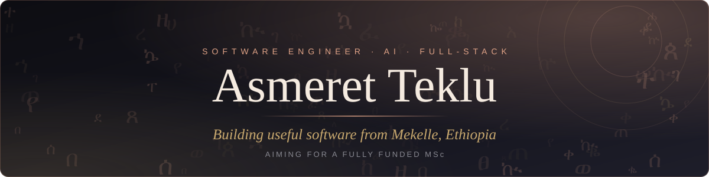
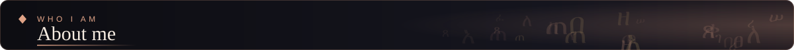
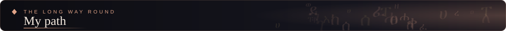
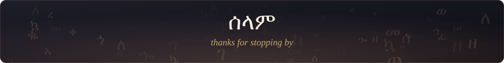

 

*I write code to solve real-world problems and tell stories* ✦

 

 

**Forged in resilience, engineered for impact.**

I studied through internet blackouts and power cuts, from handwritten notes and printed pages, sometimes by candlelight. I graduated in August 2025 with a **3.74 GPA, Great Distinction**, in Software Engineering at Microlink IT College.

Now I build software for the conditions I know: slow internet, power cuts, users who speak Tigrinya and Amharic. *Those are not edge cases to me. They are the main case.*

I design the architecture and direct AI-assisted development, then review, test and take ownership of what ships. Next step: a **fully funded MSc in Computer Science**, to go deeper and bring more tools back home.

| TIGRINYA | ENGLISH | AMHARIC |
|:---:|:---:|:---:|
| Mother tongue | Full fluency | Full professional |

 

 

> Most of my repositories are private. Each project has a write-up, screenshots and a demo on my portfolio, and I'm happy to share code access with reviewers on request.

| Project | What it is | Stack | |
|:--|:--|:--|:--|
| **Keno Platform** | Role-based lottery management system | React · Node.js | [Portfolio](https://asmeret.netlify.app) |
| **Luna** | Cycle-tracking and women's health app with an AI assistant, built for Ethiopian and African women, in Amharic and English | React Native · Expo · Supabase · Gemini API | [Portfolio](https://asmeret.netlify.app) |
| **Microlink Registration System** | Cut student registration and fee payment at my college from up to 7 days to minutes | HTML/CSS/JS · PHP · MySQL | [Portfolio](https://asmeret.netlify.app) |
| **[Lottery Platform](https://github.com/asmeretteklu/lottery-platform)** | Lottery backend and admin panel: phone-OTP login, transactional ticket purchase, Redis-locked audited draws, row-level security | React · Express · Supabase · Redis | [Code](https://github.com/asmeretteklu/lottery-platform) |

 

- 🧠 &nbsp;**Bilingual AI** — Tigrinya and English NLP
- 📡 &nbsp;**Offline-first mobile** — sync for low-connectivity places
- 🏗️ &nbsp;**System design** — scalable architecture patterns

 

I started my degree in 2019. COVID came, then war in Tigray, and classes stopped for three years. I kept studying anyway, then compressed the missed semesters to catch up, passed the national exit exam, and graduated. I kept building along the way, and I still do, while supporting my family.

I want to keep learning at graduate level and bring that knowledge back to where I live.

 

